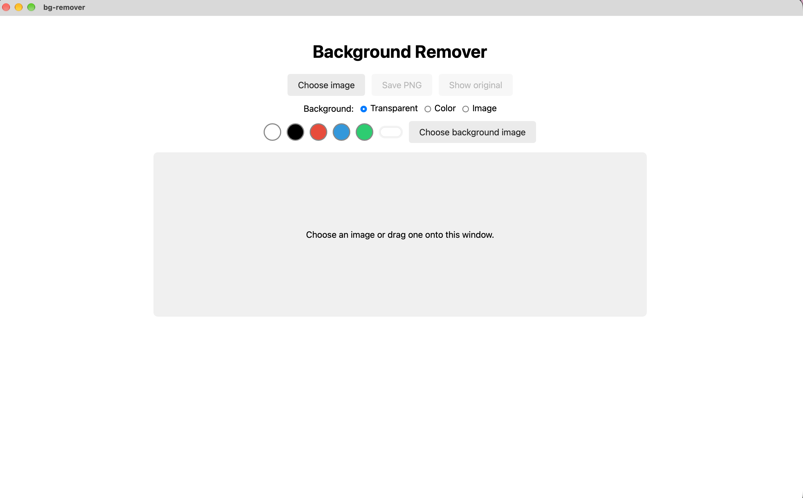
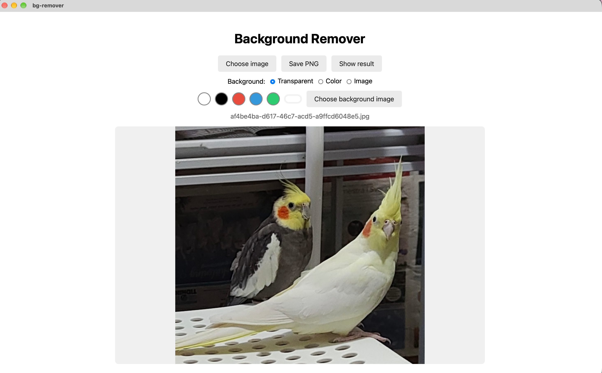
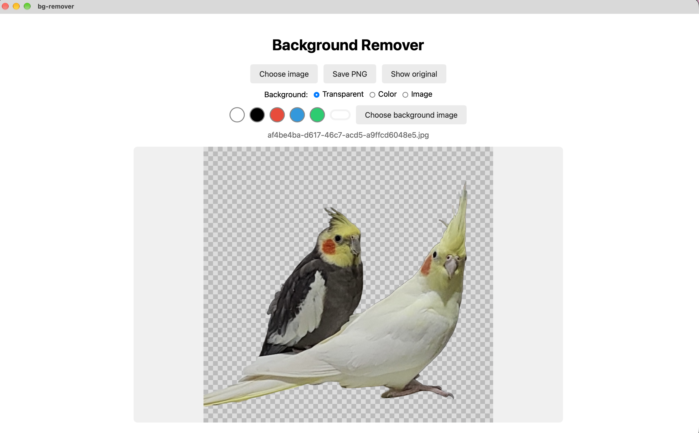
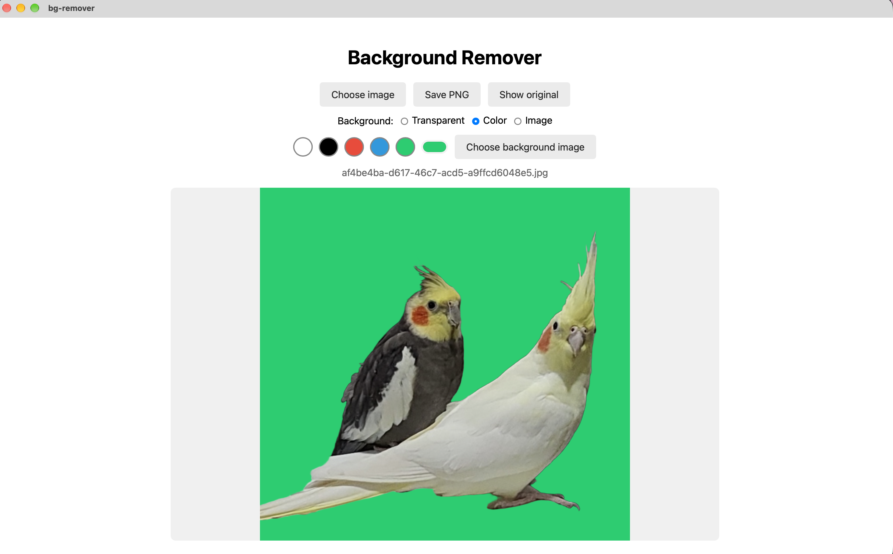
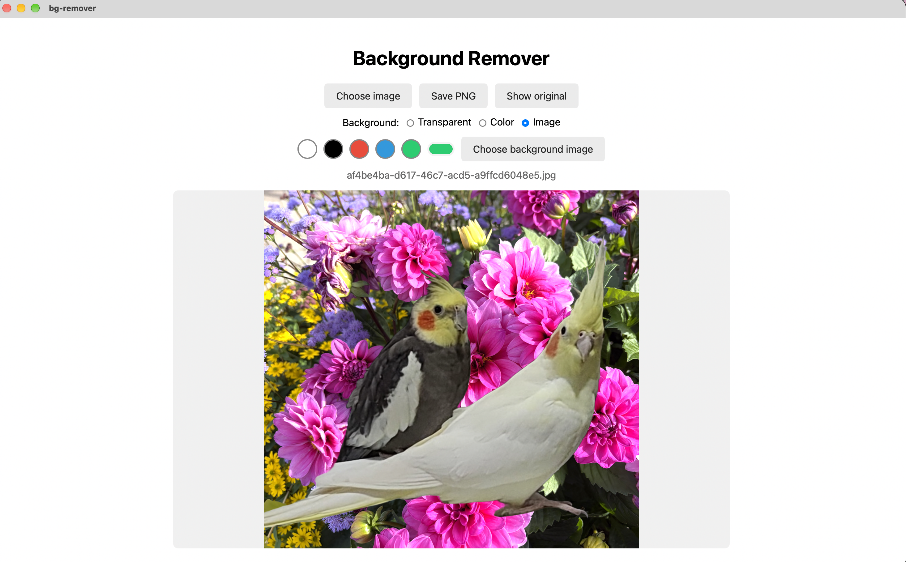

 <p align="center">
  
</p>

<h1 align="center">BG Remover</h1>

<p align="center">
  BG Remover uses BiRefNet Lite with ONNX Runtime to remove image backgrounds directly on your computer.
</p>

<p align="center">
  No cloud processing and no separate AI model download required.
</p>

## Features

- **AI Background Removal** — Automatically remove image backgrounds using BiRefNet Lite ONNX.
- **Transparent PNG Export** — Export images with transparent backgrounds.
- **Custom Backgrounds** — Replace removed backgrounds with a solid color or another image.
- **Local Processing** — Images are processed locally on your computer.
- **Bundled AI Model** — The ONNX model is included with the application. You can also replace it in the source code and rebuild.
- **Cross-Platform** — Built with Tauri 2 and Rust.

## Screenshots

<p align="center">
  
  
  
  
  
</p>

## Build From Source

### Prerequisites

- Node.js
- Rust
- Tauri 2

See the [Tauri prerequisites guide](https://v2.tauri.app/start/prerequisites/).

### Install dependencies

```bash
npm install
```

### Run in development mode

```bash
npm run tauri dev
```

### Build the application

```bash
npm run tauri build
```

## License

MIT

### AI Model

[BiRefNet Lite ONNX](https://huggingface.co/onnx-community/BiRefNet_lite-ONNX)